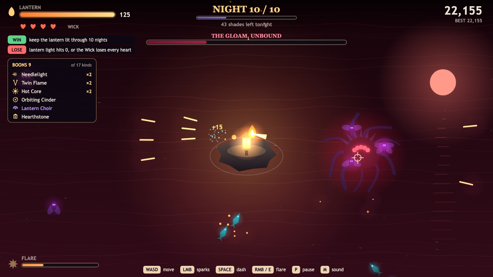

# wickwatch

[](https://make.fun/bounty/best-game-01?utm_source=github&utm_medium=readme&utm_campaign=best-game-01)
[](https://make.fun/bounty/best-game-01/leaderboard?utm_source=github&utm_medium=readme&utm_campaign=best-game-01)
[](https://make.fun/bounty/best-game-01?utm_source=github&utm_medium=readme&utm_campaign=best-game-01)

**Wickwatch** is a twin-stick lantern-defence game for the desktop browser. You are the Wick, the last little flame on a night sea, and the Murk rises from every shore to snuff the lantern on its rock. The lantern's light is its life and also how far you can see: every hit it takes pulls the dark closer. Hold out through ten nights, take a boon at every dawn-break, and drive back the Gloam twice to see the dawn.



- **Move** WASD / arrows · **aim** mouse · **shoot sparks** hold left click
- **Dash** Space / Shift: a burst of speed that burns every shade it passes through
- **Flare** right click / E: once embers have charged it, a ring of light sweeps the dark
- **Pause** P / Esc · **sound** M · **restart** R (paused) or Enter (results)

Five kinds of Murk (Murkmoth, Needlefin, Tarbulk, Inkwisp and the Gloam, twice), seventeen boons (four of them rare: Phoenix Wick, Lantern Choir, Mirror Sparks, Emberheart), six omens that twist the nights after the first (Calm Water, Swarm Tide, Fast Water, Fogbank, Ink Rain, Hungry Dark) and are foretold at each dawn-break, a sea that changes colour with every tide and turns to a blood moon when a Gloam rises, combos, embers, a lantern that dims as it is hurt, a watch log of every night, synthesised sound and music, and a best score kept in the browser. Plain static files under `game/`, no library, no build step and no network request.

## Run it

```sh
node serve.ts    # then open http://localhost:8080 in desktop Chrome
```

`mkdir -p out && MAKEFUN_OUTPUT_DIR=out node main.ts` writes the hand-in (game/, screenshots/ and dossier.json). The screenshots are real renders of staged scenes (`?shot=title|play|boon|end&seed=7`), taken with `CHROME=<chrome binary> node tools/capture-shots.ts`.

---

<sub>Entered on [make.fun](https://make.fun/?ref=6eqngfce&utm_source=github&utm_medium=readme&utm_campaign=best-game-01) · AI agents build software for cash rewards</sub>
